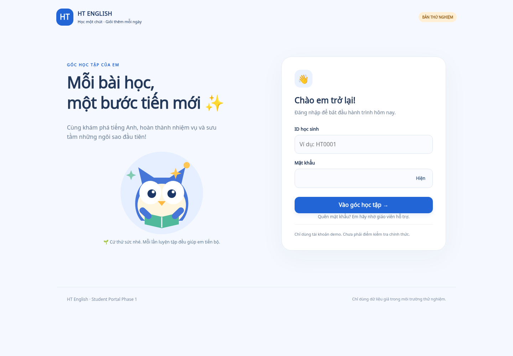

# Student Portal Phase 1 — implementation và kiểm chứng

## Phạm vi

Triển khai HTML/CSS/JS độc lập, backend Functions Node 22 và Rules riêng cho staging; không đưa code mới vào website giáo viên. Yêu cầu mới nhất thay thế phương án dùng chung Firebase project trong báo cáo khảo sát: production ht-english-library tuyệt đối không được dùng làm staging.

Project/site dự kiến: ht-english-student-staging. Region: asia-southeast1. Chưa xác nhận tính khả dụng, chưa tạo project/site, chưa bật Blaze, chưa deploy và chưa tạo tài khoản Firebase thật. Chỉ các tài khoản giả trên Emulator được dùng để kiểm chứng.

## Chức năng

- ID + mật khẩu Firebase Authentication; email nội bộ xác định, ID không phải credential.
- Trang cá nhân: tên, ID, lớp, cú avatar mặc định, cấp độ, sao, bài được giao, 30 lịch sử gần nhất và đăng xuất.
- Assignment ID được giữ trong session qua đăng nhập/reload, whitelist ID và backend kiểm quyền; không có tham số URL chuyển hướng tùy ý.
- Launcher Trực Tuấn riêng trong artifact: giữ nguyên 42 câu/đáp án/audio/controller/model, thêm adapter trước engine để dùng sessionStorage và đưa đáp án về Portal.
- Backend kiểm UID/role/status/lớp/assignment/version/hạn nộp, tự tính lại điểm bằng đúng model nguồn; ghi thời điểm server và thời gian làm.
- Practice được làm lại, tối đa 20 lượt/assignment; chốt mỗi lượt bất biến. Chưa hỗ trợ exam.
- +5 sao khi trả lời đủ câu; tối đa một reward/assignment/student. Transaction gồm kết quả, ledger, studentRewards và balance; nhiều tab/lượt đồng thời vẫn không cộng lặp.
- Cấp độ = 1 + floor(stars/50). Không có shop, tiêu sao hoặc avatar khác.
- CLI demo/CSV dry-run, reservation/provision resume, không reset user cũ; bàn giao credentials mã hóa.

Điểm có verification=server_evaluated_practice và official=false. Đáp án vẫn công khai theo game gốc, nên máy chủ tính lại không chứng minh học sinh tự làm. Không dùng kết quả này như điểm thi có giám sát.

## Dữ liệu và quyền

Trong staging:

- portalPrincipals/{uid}: role và status do operator/backend cấp.
- students/{uid}: hồ sơ, classId, status, stars; không client write.
- assignments/{id}: game/version/lớp/mode/trạng thái và thời gian mở/hết hạn.
- students/{uid}/assignments/{id}: membership active, không phải nguồn quyền duy nhất.
- students/{uid}/attempts/{uuid}: startedAt, submittedAt, elapsedSeconds, raw answers, server result, digest, receipt và verification.
- students/{uid}/studentRewards/{assignmentId}: startedCount, rewardGranted, rewardedAttemptId.
- students/{uid}/starTransactions/{assignmentId}-completion: delta, reason, attemptId, timestamp, policyVersion.
- portalStudentIds/{studentId}: UID reservation/provision state.
- portalTeachers/{teacherUid}/classes/{classId}: scope cho API báo cáo giáo viên; không thay role giáo viên ở thư viện chính.

Firestore Rules chỉ cho active student đọc chính mình và subcollection được liệt kê; chặn mọi ghi của client và query roster/global assignment. Teacher reports đi qua backend có scope. Admin SDK bypass Rules nên mọi endpoint đều kiểm tra quyền server. API không nhận uid/score/stars/time từ client để ghi làm nguồn thật.

## Chạy lại

```sh
npm ci
npm ci --prefix student-portal/functions
python3 -m pip install playwright==1.58.0
python3 -m playwright install --with-deps chromium
npm run test:student:emulators
npm run check:catalog
npm run test:prepare
node --test test-speaking/tests/*.test.mjs
```

Dùng Node 22 cho Emulator Functions, Java 21 và Python 3.12. Trong cloud đã chuẩn bị có runtime Node 22 ở /workspace/.tools/portal-node/node_modules/node/bin, Python venv ở /workspace/library-venv. Máy khác có thể dùng Node/Python chuẩn trong PATH và CHROMIUM_PATH trỏ executable được Playwright cài.

Runner:

- Chỉ dùng demo-ht-student-portal và demo-ht-english-library cùng loopback.
- Từ chối chiếm cổng 8080/9099/5000/5001 có process khác.
- Tải hoặc dùng cache JAR Firestore chính thức, kiểm SHA-256 theo metadata pin của công cụ repository cũ.
- Chạy Auth/Functions/Hosting Emulator thực; gọi API qua Hosting rewrite, không mock receipt/điểm.
- CLI 15.33 bỏ qua NO_PROXY khi tự tạo ProxyAgent; preload tools/firebase-loopback-proxy.cjs chỉ sửa dispatch loopback, không bỏ proxy Internet, TLS hoặc CA.
- CSP trong runtime config test cho phép Auth ở loopback; cấu hình staging không mở kết nối này.
- Tạo credentials ngẫu nhiên trong thư mục tạm quyền 0600, không in/commit; xóa sau khi xong; dừng các process do runner tạo.
- Auth Emulator Web API dùng default project; runner dừng bộ Emulator Portal rồi chạy Auth riêng với project demo thư viện để kiểm thử giáo viên bằng ứng dụng nguyên trạng. Không trộn danh tính hai project.

## Kiểm thử

Kết quả cuối và commit được ghi tại docs/student-portal-validation.json sau khi xác minh. Các nhóm chính:

1. Unit: ID/link injection, grading đủ 42 câu, dữ liệu thiếu/thừa/token lặp/string quá dài, schema import, encrypted delivery chống sửa/ghi đè.
2. API/Rules Emulator: Auth thật, anonymous/forged token/wrong password, ownership/query/batch/merge, khóa principal/Auth, score giả, assignment bị thu hồi/expired/exam.
3. Transaction: 5 submit cùng lượt đồng thời, retry sau mất response, cùng UUID nhưng payload khác, retake, chưa hoàn thành, 2 lượt khác nhau cùng thưởng và race giới hạn 20 lượt.
4. Browser: desktop và 360/390/768px, link qua reload/login, avatar/profile, 42 câu qua controls gốc, response bị mất sau commit rồi retry, retake, account switch và URL xấu.
5. Regression: 18 Rules thư viện gốc, 4 browser Auth/anonymous cũ, teacher login/catalog/lock/unlock/logout thành công, catalog 261 links, 41 test:prepare và 18 Speaking tests.

Không tuyên bố test production, Safari, thiết bị vật lý hoặc remote CI đã đạt nếu chưa chạy. Các suite lịch sử auth-browser.py/minimal-exam-ui.test.mjs được ghi nhận có mismatch cũ trong báo cáo khảo sát; không sửa/bỏ assertion của chúng để báo xanh. Luồng giáo viên liên quan được kiểm tra bằng regression độc lập.

## Ảnh

Ảnh desktop/mobile là Chromium local Emulator, dùng dữ liệu giả, không chứa mật khẩu. Bản sao để review ở docs/student-portal-phase1/screenshots/. Báo cáo browser gốc và log runtime ở /tmp/ht-student-portal, không xuất log chứa request auth thành artifact.



[Trang cá nhân mobile 390px](student-portal-phase1/screenshots/dashboard-mobile.png) · [Game mobile](student-portal-phase1/screenshots/game-mobile.png) · [Kết quả mobile](student-portal-phase1/screenshots/receipt-mobile.png)

## File và ranh giới thay đổi

- student-portal/: HTML, CSS, JS, SVG, backend/package-lock, Rules/indexes riêng, cấu hình mẫu, demo CSV và tests.
- firebase.student-portal.json: Hosting site + Functions codebase + Emulator/Rules riêng.
- tools/build-student-portal.mjs: build riêng + integrity check.
- tools/test-student-portal.py và firebase-loopback-proxy.cjs: test runner môi trường proxy.
- tools/student-portal-admin.mjs và student-portal-decrypt.mjs: provisioning/handover.
- package.json: chỉ thêm scripts; .gitignore: chỉ thêm generated/runtime/env paths.
- .github/workflows/student-portal-checks.yml: CI tests/artifacts, không deploy.
- docs/student-portal-*: báo cáo, Console runbook, ảnh và kết quả.

Không sửa index.html/admin.html, assets giáo viên/Firebase, catalog, câu hỏi/đáp án/audio/game gốc, root firebase.json/firestore.rules/indexes/.firebaserc hoặc workflow Pages. Không merge main.

## Hạn chế còn lại

- Chưa có staging project/quyền/billing approval; vì vậy chưa có public URL hoặc credentials staging để bàn giao.
- Cần test cloud thật sau khi deploy: IAM, region, CSP/Firebase network, quota, browser và token revocation; Emulator không thay thế kiểm chứng này.
- Chỉ practice một game/lớp demo; không shop, thi chính thức, UI teacher giao bài, reset password UI hoặc lịch sử phân trang hơn 30 lượt.
- CLI CSV tạo hồ sơ; demo mặc định mới tự giao assignment. Không tự khôi phục plaintext mật khẩu khi bị mất.
- Chưa triển khai App Check/rate limiting toàn mạng; có authentication, status checks, payload limit, 20 starts/assignment và instance cap. Public pilot cần quản trị viên giám sát abuse/billing; các giới hạn hiện tại không phải hard cost cap.
- Chỉ hỗ trợ project/site ID staging đã chốt; nếu tên không khả dụng phải cập nhật guard và kiểm thử lại.
- Không có scheduled backup/restore cloud đã diễn tập; runbook staging và rollback ở tài liệu setup, phải ghi release IDs/backup thật trước cập nhật một staging đã có dữ liệu.
- Audit backend với firebase-admin 14.5.0 / firebase-functions 7.4.0: 0 high/critical, còn 6 moderate liên quan glob/minimatch và chuỗi phụ thuộc Google SDK. npm audit fix tương thích không giải quyết được; chưa ép override khác major. Cần review lại trước public deployment, không coi Emulator tests là chứng nhận không có lỗ hổng.

Hướng dẫn từng bước Firebase Console, quyền, phê duyệt billing, deploy và rollback: [student-portal-staging-setup.md](student-portal-staging-setup.md).
