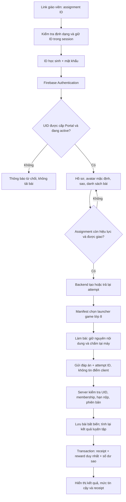

# HT English — Khảo sát và đề xuất Student Portal Phase 1

Ngày: 31/10/2026. Repository: htenglish232/library. Commit khảo sát: caaae56345ac50abda9b06973475b3095859715e.
Nhánh tài liệu: feature/student-portal-phase1.
Trạng thái: đề xuất để duyệt trước khi lập trình; chưa triển khai Portal.

## 1. Kết luận và phạm vi khảo sát

Đề xuất tạo ứng dụng học sinh trên Firebase Hosting site riêng, dùng Firebase project ht-english-library nếu kiểm tra cấu hình thật xác nhận phù hợp. Giữ nguyên GitHub Pages, đăng nhập giáo viên, Admin UID và các collection thư viện hiện có. Dùng namespace collection mới có tiền tố portal, một backend tin cậy để quản lý tài khoản, nhận bài và thưởng sao. Thí điểm đúng một game lớp 8 dưới dạng luyện tập.

Đây là khảo sát mã nguồn và bằng chứng Emulator trong môi trường phát triển. Chưa xác minh cấu hình Authentication thật, Rules đang phát hành, dữ liệu/tài khoản thật, vùng Firestore, billing plan, IAM, quota hay cấu hình Hosting trong Console. File cấu hình trong Git không chứng minh cấu hình production giống hệt. Không gọi công cụ ghi production, không tạo tài khoản thật, không deploy, không đổi Rules thật.

Điều kiện trước phát hành: người có quyền dự án kiểm tra và lưu bằng chứng chỉ đọc của Auth providers, password policy, authorized domains, Rules đang phát hành, database region, indexes, ứng dụng khác cùng project, IAM và billing. Có thể dùng tools/firebase-preflight.mjs cho phạm vi mà công cụ hỗ trợ; công cụ này không kiểm kê đầy đủ Auth/users và không phải bản backup toàn bộ Firebase.

## 2. Kiến trúc hệ thống hiện tại

| Thành phần | Bằng chứng trong repository | Hành vi và giới hạn |
| --- | --- | --- |
| Website chính | index.html; assets/library.js | Trang tĩnh, tải danh mục sau khi xác thực và kiểm tra quyền; 261 đường dẫn trong catalog release hiện tại |
| Firebase Web SDK | assets/firebase-config.js; firebase-client.js; firebase-sdk.js; tools/build.mjs | Project ht-english-library; SDK bundle cục bộ; config Web công khai không phải service-account credential |
| Đăng nhập | assets/session.js | Email/mật khẩu Firebase Auth, browserSessionPersistence; xóa ô mật khẩu sau thao tác; có quên mật khẩu qua email |
| Giáo viên | libraryMembers/{uid} | status active/locked/revoked; theo dõi thay đổi bằng listener; không chấp nhận quyền chỉ từ cache |
| Admin | ADMIN_UID trong config và Rules | Một UID cố định; Admin quản lý membership và danh mục, không có cơ chế role student |
| Danh mục | libraryCatalog/current; assets/catalog-store.js | Schema v1/v2; dataJson, hash, revision; transaction chống ghi đè phiên cũ |
| Lịch sử | libraryCatalogHistory/{revision} | Snapshot bắt buộc cùng transaction; không cho sửa/xóa lịch sử từ client |
| Game | grade-6, grade-7, grade-8; shared-practice | HTML/JS/audio tĩnh; nhiều launcher dùng chung engine/model; không có backend nộp bài học sinh |
| Tiến độ game | shared-practice/dual-store.js; dual-progress.js | localStorage theo đề + tên/mã nhập; kiểm tra cấu trúc và tính lại XP; không phải danh tính Auth hoặc bằng chứng chống gian lận |
| Hosting/deploy | .github/workflows/pages-manual.yml; tools/prepare-site.mjs | GitHub Pages, workflow thủ công; đóng gói .site; không thấy cấu hình Firebase Hosting/Functions hiện hành |
| Emulator | firebase.json; .firebaserc; tools/test-emulators-official.py | Demo project, Auth 9099/Firestore 8080, local loopback; fallback chính thức có kiểm tra SHA-256 |

### Quyền hiện tại

- Anonymous: không đọc/ghi Firestore ứng dụng.
- Teacher active: đọc catalog/current, đọc membership của chính mình; không liệt kê giáo viên, sửa quyền hoặc ghi catalog.
- Teacher locked/revoked/unapproved: không đọc catalog.
- Admin UID cố định: quản lý membership theo schema hẹp; sửa catalog phải lưu lịch sử nguyên tử.
- Các collection/subcollection khác: deny mặc định.
- Admin UI cấp membership cho UID đã có; không thấy công cụ tạo Firebase Auth users hàng loạt.

Điểm cần hiểu đúng: cổng đăng nhập bảo vệ danh mục Firestore và giao diện thư viện. GitHub Pages vẫn phục vụ HTML, JavaScript, audio và đáp án nếu biết đường dẫn. tests/auth-login-browser.py còn có kịch bản mở trực tiếp đề khi chưa đăng nhập. Firestore Rules không thể bảo vệ file tĩnh trên Pages.

Điều hướng thư viện lấy đường dẫn qua catalog được kiểm tra trong assets/catalog-data.js, rồi nhóm trường/đề bằng school-folders.js. Trạng thái ẩn/xóa và release additions có logic riêng; Portal không nên tái sử dụng toàn bộ catalog giáo viên như danh sách bài học sinh.

### Thành phần tái sử dụng

- Firebase project/Web SDK và cơ chế kết nối Emulator; mô hình kiểm tra quyền theo UID và fail closed.
- Dữ liệu câu hỏi, model.js, audio, giao diện đọc/nghe và tiến độ của một game thí điểm.
- Cách kiểm tra schema/đường dẫn, transaction, kiểm thử Rules và browser test hiện có.
- Quy trình artifact/review, hash bảo toàn nội dung, công cụ preflight/rollback làm nền cho runbook mới.

Không gắn student vào libraryMembers, không đổi Admin UID, không mở rộng activeTeacher để bao gồm học sinh. Tên/mã tự nhập và localStorage không được dùng để xác định chủ sở hữu bài nộp.

### Bằng chứng kiểm thử đã có trong phiên chuẩn bị môi trường

Cùng commit trên: build SDK khớp byte với bundle trong Git; catalog 261 URL đạt; 41 test:prepare + 18 test Speaking + 18 Rules đạt; Speaking browser đạt 8 nhóm. Server HTTP phục vụ JSON thật thành công. Đây là kiểm chứng môi trường hiện tại, không phải kiểm chứng production.

Hai lỗi repository đã xác định:

1. tests/auth-browser.py dừng ở dòng 162: bấm #results-button khi nút nằm trong details #minimal-tools đang đóng do minimal-ui.js. Các bước đăng nhập/khóa quyền trước đó đạt; phần còn lại chưa chạy xong. Cần sửa test theo giao diện hiện tại trong công việc lập trình riêng.
2. tests/minimal-exam-ui.test.mjs đạt 3/4; kiểm tra bảo toàn byte thất bại ở index.html so với baseline 3691356 cũ, trước tích hợp Speaking hiện tại. Cần xác lập lại baseline được review, không tự cập nhật hash để làm test xanh.

## 3. Thiết kế đăng nhập và giao diện học sinh

### Danh tính và mật khẩu

- Mỗi học sinh có Firebase Auth UID riêng, không suy ra quyền từ ID hiển thị.
- ID công khai, duy nhất trong trung tâm, ví dụ HT-8A-001. Chuẩn hóa một quy tắc duy nhất: ASCII viết hoa, chỉ chữ/số/dấu gạch nối, giới hạn độ dài; không tái sử dụng ID của tài khoản đã lưu hồ sơ.
- Ánh xạ xác định ID sang email nội bộ như ht-8a-001@students.htenglish.invalid. Đây là định danh kỹ thuật không nhận thư; không cần public collection để tra cứu ID. UID vẫn là khóa dữ liệu.
- Mặc định chọn mật khẩu ngẫu nhiên ít nhất 12 ký tự. Không chọn PIN 4–6 số cho lần đầu. Nếu sau này bắt buộc PIN ngắn: cần thiết kế cổng xác thực phía server, hạn chế thử sai và phục hồi riêng trước khi duyệt.
- Firebase Auth quản lý thông tin xác thực; không lưu mật khẩu/PIN/hash mật khẩu trong Firestore, localStorage, log hoặc mã nguồn. Chỉ token phiên do SDK quản lý.
- Không bật đăng ký trên UI học sinh. Dù ai đó tự tạo được Auth user qua API, UID không được provision vào portalPrincipals nên vẫn bị từ chối mọi dữ liệu Portal.
- Khôi phục mật khẩu qua công cụ Admin được xác thực, không dùng email giả để gửi reset. Không cho nhập ID để lấy mật khẩu. Nếu cần bắt buộc đổi mật khẩu lần đầu, backend giữ cờ và chặn dữ liệu/bài tập đến khi hoàn tất quy trình đổi mật khẩu đã được kiểm chứng; ẩn nút ở UI là chưa đủ.
- Portal dùng origin riêng và phiên session để giảm ảnh hưởng thiết bị dùng chung. Đăng xuất xóa state nhạy cảm trong ứng dụng; không tự nhập tiến độ localStorage của người dùng trước.

### Màn hình mobile

1. Đăng nhập: “ID học sinh”, “Mật khẩu”, nút hiện/ẩn mật khẩu, “Đăng nhập”, “Nhờ giáo viên hỗ trợ”. Lỗi chung, không tiết lộ ID có tồn tại.
2. Trang cá nhân: tên, lớp, avatar mặc định cục bộ, số sao đã được server ghi nhận, bài được giao và trạng thái.
3. Khi có bài từ link: thẻ bài được ưu tiên cùng nút “Bắt đầu làm bài”; vẫn có nút về trang cá nhân.
4. Trong bài: tên bài, nhãn “Luyện tập”, tiến độ, “Nộp bài”; khi mạng lỗi hiển thị chưa gửi/chờ gửi, không báo thành công sớm.
5. Kết quả: tách “Điểm luyện tập” khỏi “Điểm chính thức”, ghi rõ trạng thái xác minh và sao đã/chưa được cấp.

Thiết kế tiếng Việt, cỡ chữ dễ đọc, vùng chạm khoảng 44px, hỗ trợ bàn phím/focus/screen reader, kiểm tra rộng 360/390/768px và không tràn ngang. Không cần nhập tên/lớp mỗi lần làm bài; lấy từ hồ sơ được cấp.

### Giữ bài từ link và chặn open redirect

Link đề xuất chỉ chứa assignment ID: /?assignment=as_8a_tt_001.
Chuỗi này không phải URL và không cấp quyền. Kiểm tra format/length, từ chối tham số trùng hoặc encoding mơ hồ; lưu duy nhất ID đã hợp lệ trong sessionStorage để giữ qua tải lại đăng nhập.

Sau đăng nhập, đọc assignment bằng quyền thực của UID; kiểm tra đang mở, có trong danh sách được giao và game/version được hỗ trợ. Tra gameId trong manifest do build/backend kiểm soát để lấy đường dẫn tương đối cố định. Không nhận next, redirect, returnUrl hoặc đường dẫn game trực tiếp từ query. Không gọi location.assign với đầu vào tùy ý. Bài không tồn tại/hết hạn/không được giao: thông báo chung và về dashboard, không tải iframe.

## 4. Luồng đăng nhập và làm bài

Retry khi mất mạng dùng lại attempt ID/idempotency key. Khác UID hoặc đổi assignment không được tái sử dụng attempt. Hết phiên phải đăng nhập lại rồi backend kiểm tra lại quyền, không tự tạo bài nộp dưới tài khoản khác.

## 5. Firestore đề xuất

Tên trường chỉ là hợp đồng thiết kế, chưa tạo collection/index/Rules. Dùng Timestamp server, UID cho chủ sở hữu, integer không âm cho số đếm. Không lưu danh sách học sinh toàn lớp trong một document công khai; không chứa đáp án riêng trong document học sinh được đọc.

| Đường dẫn | Dữ liệu chính | Quyền dự kiến |
| --- | --- | --- |
| portalPrincipals/{uid} | role student/teacher/admin, status, schemaVersion, createdAt, updatedAt | Chính chủ get trạng thái; không client write; backend provision. Admin quản lý qua API |
| portalStudents/{uid} | studentId, displayName, classId, avatarId=default-v1 | Student get chính mình; teacher lớp được phân công đọc qua API; backend ghi |
| portalStudents/{uid}/preferences/ui | locale, reducedMotion | Chính chủ get/create/update với hasOnly/type/size nghiêm ngặt; không xóa hồ sơ, đổi avatar/name/class |
| portalClasses/{classId} | name, schoolYear, status | Teacher được phân công qua API; không cho học sinh list roster |
| portalClassTeachers/{classId}/teachers/{uid} | status, assignedAt | Backend ghi; dùng kiểm tra phạm vi giáo viên |
| portalClasses/{classId}/members/{studentUid} | status, enrolledAt | Backend ghi; không cho student tự gia nhập |
| portalAssignments/{assignmentId} | classId, gameId, contentVersion, mode=practice/exam, status, opensAt, dueAt, maxAttempts, rewardPolicyVersion, createdBy | Chỉ người được giao hoặc teacher lớp được phân công đọc; backend ghi |
| portalStudents/{uid}/assignmentRefs/{assignmentId} | title, status summary, assignedAt | Danh sách được giao; chính chủ query có phân trang; mọi trường do backend đồng bộ |
| portalStudents/{uid}/attempts/{attemptId} | assignmentId, gameId, contentVersion, status, startedAt, submittedAt, answers, clientReportedScore, evaluatedScore, verification, submissionDigest | Chính chủ đọc; chỉ backend ghi và chốt bài; answers giới hạn kích thước và schema |
| portalStudents/{uid}/wallet/main | balance, lifetimeEarned, updatedAt | Chính chủ read; chỉ backend transaction write |
| portalStudents/{uid}/starLedger/{rewardKey} | delta, reason, assignmentId, attemptId, policyVersion, createdAt, actorUid, reversalOf | Bất biến, chính chủ read, backend create |
| portalRewardPolicies/{version} | điều kiện thưởng, mức sao, giới hạn, hiệu lực | Backend sở hữu; client không sửa |
| portalStudentIds/{normalizedId} | uid, status, importBatchId | Chỉ backend; giữ uniqueness/reservation, không cho tra cứu công khai |
| portalImportJobs/{jobId} và portalAudit/{eventId} | trạng thái, actor, counts, ID tham chiếu, requestId | Admin qua API; không chứa mật khẩu, token hay CSV thô |

Tách assignmentRefs summary khỏi dữ liệu gốc; refs không phải căn cứ duy nhất cấp quyền. Rules/API kiểm tra assignment thực, active principal, lớp/membership hiện tại và chính sách thu hồi. Rules không phải bộ lọc: dashboard query dưới đường dẫn UID của chính mình; không query toàn bộ attempts rồi mong Rules tự lọc.

Tránh nhân bản trạng thái làm nguồn quyền mâu thuẫn. Backend định nghĩa principal là trạng thái tài khoản, membership là phạm vi lớp; bị khóa ở một trong hai thì không nộp bài. Nếu hỗ trợ chuyển lớp, giữ quyền xem kết quả cũ của chính mình, nhưng dừng quyền làm bài mới của lớp cũ theo chính sách đã duyệt.

Indexes dự kiến: assignmentRefs theo status + assignedAt; attempts theo assignmentId + submittedAt; audit theo actorUid + createdAt. Chỉ thêm sau khi chốt query thực. Miễn index cho payload answers/clientReportedScore không truy vấn và các blob lớn; không lưu audio/base64 trong Firestore.

### Ma trận quyền và backend

| Đối tượng | Được phép | Bị cấm |
| --- | --- | --- |
| Student active | Đọc hồ sơ, bài được giao, bài nộp, ví và lịch sử của mình; sửa preferences theo whitelist; gọi API tạo/nộp attempt | Đọc bạn khác; sửa role/status/class; ghi điểm, sao, ledger; tự giao bài |
| Teacher active | Qua API: quản lý bài và xem tiến độ lớp mình được phân công | Tự tăng quyền, thao tác lớp khác, tạo Auth user hàng loạt, tự sửa ví |
| Portal Admin | Qua API được audit: cấp tài khoản, phân lớp/teacher, khóa/reset, quản lý policy và hiệu chỉnh có lý do | Đưa credential Admin SDK vào client; sửa log/ledger tùy ý |
| Backend service identity | Thực hiện các thao tác được giao bằng IAM tối thiểu | Dùng quyền rộng không cần thiết, log secrets, tin role/uid do request body cung cấp |

Giữ nguyên ba match Rules cũ và deny mặc định. Các rule mới chỉ match namespace portal cụ thể; không thêm allow cho toàn database. Quyền Portal teacher không tự xuất hiện từ client claim hoặc libraryMembers: backend cần cả membership giáo viên hiện hành và phân công lớp Portal. Admin hiện hữu được bootstrap vào Portal theo UID cố định; không di trú quyền thư viện trong Phase 1.

Admin SDK bỏ qua Firestore Rules: mọi API phải verify ID token (và revocation khi cần), kiểm tra trạng thái server, xác định actor từ token, kiểm tra class scope/ownership, validate payload và chỉ ghi các đường dẫn định trước. Custom claims nếu bổ sung chỉ là tín hiệu role thô; không thay thế kiểm tra khóa tài khoản hiện hành.

## 6. Game lớp 8, điểm và sao

### Game thí điểm

Chọn Trực Tuấn: grade-8/De_thi_GHK1/1_THCS Truc Tuan/truc-tuan-dual-mode.html, 42 câu.
Tái sử dụng truc-tuan-dual-data.js, model.js, dual-progress.js và audio liên quan. Dữ liệu có contentVersion; registry mới phải pin gameId, contentVersion và hash các tài nguyên.

Tạo launcher/adapter Portal riêng, build sao chép đúng các tài nguyên cần dùng vào artifact Hosting. Không đổi launcher cũ, engine dùng chung, câu hỏi, đáp án, normalize/chấm điểm hay khóa localStorage cũ. Nếu muốn hook sự kiện thay vì quan sát state, tạo controller dành riêng cho pilot; mọi nhu cầu sửa shared engine phải được review riêng và kiểm thử hồi quy toàn bộ game chịu ảnh hưởng.

Nếu dùng iframe để giữ giao diện game: chỉ src cố định trong manifest; bridge kiểm tra event.origin, event.source đúng frame và schema, ràng buộc attempt/nonce để chống nhầm phiên. postMessage không làm điểm trở nên đáng tin: mã game/client vẫn có thể bị can thiệp. Không gửi token qua query/iframe URL; kết quả chỉ được parent gửi lên API bằng phiên của UID thật. Không dựa vào iframe cùng origin như ranh giới bảo mật.

### Ba mức kết quả

1. client_reported: điểm trình duyệt tự tính; chỉ dùng hiển thị tham khảo.
2. server_evaluated_practice: server tính lại từ raw answers và phiên bản đáp án pin, với cùng quy tắc model.js đã đối chiếu; vẫn là luyện tập vì đáp án công khai, không chứng minh học sinh tự làm.
3. teacher_approved/official: chỉ được phát hành sau quy trình thi/chấm riêng; không nâng cấp tự động điểm luyện tập thành điểm kiểm tra.

Phase 1 chỉ mở practice. Assignment exam có thể có schema nhưng backend phải từ chối khởi chạy ở Phase 1. Thi chính thức cần luồng riêng: đáp án không có trong bundle công khai, đề/version bất biến, thời gian server, hạn lượt thi, thời điểm công bố lời giải, chấm phía server/giáo viên và chính sách chống gian lận phù hợp. Không thể bảo mật đáp án đã nằm trên GitHub Pages bằng Rules.

### Ghi nhận bài và chống thưởng lặp

- Server tạo attemptId và lưu assignmentId, UID, contentVersion, thời điểm và trạng thái. Mở lại trả attempt đang làm; không tạo lượt mới mỗi lần reload.
- Khi nộp: validate số câu/ID/kiểu đáp án, giới hạn payload, trạng thái assignment, thời gian server và maxAttempts; tính digest payload chuẩn hóa. Không lấy UID, class, score, stars từ client làm nguồn sự thật.
- Cùng attempt + cùng digest: trả receipt cũ. Cùng attempt + digest khác sau khi chốt: conflict; không ghi đè kết quả đã nhận.
- Việc kiểm tra đã đủ maxAttempts cũng cần transaction/counter phía server để chống hai tab mở cùng lúc.
- Chính sách ban đầu đề xuất: tối đa một thưởng hoàn thành cho mỗi học sinh/assignment, độc lập số lần làm và các lần review. Mức thưởng cụ thể chờ duyệt; XP hiện tại không quy đổi tự động thành sao.
- rewardKey dùng assignmentId + loại thưởng trong namespace UID; không đưa attemptId hoặc policyVersion vào phần duy nhất nếu điều đó cho phép nhận lại thưởng sau khi làm lại/đổi policy.
- Một transaction đọc attempt, wallet và rewardKey, chốt kết quả, create ledger nếu chưa có và cập nhật số dư. Retry do mạng, hai tab, trigger chạy lại đều gặp cùng ledger key. Khi đã có thưởng, attempt hợp lệ khác có thể lưu nhưng không cộng lại.
- Nếu cần điều chỉnh, tạo giao dịch bù có lý do/actor và khóa idempotency riêng; không sửa/xóa giao dịch cũ. Chưa có cửa hàng, chuyển sao hay tiêu sao.
- Nếu server chưa có đủ thông tin để tự đánh giá, giữ verification=client_reported và reward pending; teacher duyệt qua backend trước khi cấp sao. Không hứa điểm xác thực chỉ vì request đã được Firebase Auth ký.

## 7. Tạo tài khoản hàng loạt bằng công cụ quản trị

Đề xuất CLI Node riêng, dùng Firebase Admin SDK và ADC/Workload Identity của người vận hành; không dùng Web Admin page để giữ service-account key.

Đầu vào chuẩn CSV UTF-8: studentId, displayName, classId; template không có cột mật khẩu. Excel lưu/export CSV cho Phase 1; chưa cần nhận XLSX/macro trực tiếp. Kiểm tra BOM/Unicode, trùng ID, lớp hợp lệ, kích thước/số dòng và toàn bộ lỗi trước khi apply. Khi xuất báo cáo cho Excel phải xử lý formula injection với ô bắt đầu bằng =, +, -, @.

Luồng: dry-run mặc định → báo cáo tạo mới/xung đột → người có quyền chủ động apply đúng project và batch đã duyệt → cấp credentials qua kênh riêng. Không chạy trong khảo sát.

Thiết kế import có jobId và reservation ID duy nhất. Auth và Firestore không cùng transaction: dùng state machine pending → auth_created → provisioned, UID ổn định cho từng record và retry có đối chiếu. Account mới chưa provisioned bị chặn. Phát hiện tài khoản mồ côi để reconcile; không tự reset mật khẩu, ghi đè hoặc xóa user có sẵn khi import lại. Không gán role từ cột CSV.

Mật khẩu ban đầu sinh bằng CSPRNG trong bộ nhớ và gửi một lần qua kênh được trung tâm duyệt. Nếu phải có file bàn giao: mã hóa, quyền truy cập tối thiểu, ngoài repo/artifact/log CI, có TTL và xóa sau bàn giao. Không in ra stdout/chat. Chỉ lưu audit counts/UID/jobId; không lưu mật khẩu để “xem lại”. Mất mật khẩu thì reset có audit.

Khóa tài khoản phải cập nhật status, disable Auth và revoke refresh tokens theo runbook. Rules/API vẫn kiểm tra status để không phụ thuộc thời gian hết hạn ID token. Không thay password policy toàn project mà chưa đánh giá tác động giáo viên.

## 8. Rủi ro và biện pháp

| Rủi ro | Biện pháp bắt buộc |
| --- | --- |
| Tưởng game có bảo mật do danh mục yêu cầu login | Công bố rõ file tĩnh công khai; pilot chỉ practice; thi riêng sau |
| Đoán PIN, dò ID, credential stuffing | Mật khẩu mạnh, lỗi chung, throttling Auth/backend, giám sát; bảo vệ signup/abuse và email enumeration phải thử trên staging |
| Student tự cấp quyền hoặc đọc bạn khác | UID token + provisioned principal, deny mặc định, whitelist fields, ownership và class scope server |
| Client sửa điểm hoặc giả postMessage | Gắn nhãn client_reported, server tính lại, không tin origin là bằng chứng điểm |
| Nhận sao lặp khi retry/import/trigger | Transaction, reward key ổn định, ledger bất biến, kiểm thử đồng thời |
| Open redirect/path traversal | Query chỉ assignment ID, manifest đường dẫn cố định, kiểm tra lại quyền sau login |
| Token bị lộ/XSS | Không token trong URL/log; textContent cho tên/dữ liệu; CSP, kiểm tra SDK bundle/dependency; App Check là lớp bổ sung, không thay Auth/rules |
| Backend Admin SDK bypass Rules | IAM tối thiểu, authz trong từng API, không endpoint ghi đường dẫn tùy ý, audit |
| Dữ liệu trẻ em, thiết bị chung | Chỉ tên hiển thị/lớp/ID cần thiết; avatar mặc định; không thu ngày sinh/ảnh/micro; consent/quy trình phụ huynh phù hợp; retention đề xuất 1 năm học chờ duyệt |
| Cùng project làm ảnh hưởng giáo viên hoặc phát sinh hóa đơn | Namespace/site/service riêng, staging project riêng, deployment target rõ, feature flag server, quota và cảnh báo toàn project |
| Rollback giao diện nhưng còn write đang chạy | Đóng API nộp/thưởng bằng feature flag server; tính tương thích schema; không khôi phục database tràn lan |

App Check/reCAPTCHA cần đánh giá hỗ trợ trên từng Firebase API, thiết bị học sinh và Emulator; không coi là chống gian lận hoặc công cụ giới hạn chi phí tuyệt đối. Không bật enforcement ngay trên ứng dụng giáo viên hiện có.

## 9. File dự kiến tạo/sửa sau khi duyệt

Các đường dẫn sau là đề xuất, chưa tồn tại trừ những file ghi rõ “sửa”.

| File/nhóm | Mục đích |
| --- | --- |
| student-portal/index.html; assets/app.js, auth.js, api.js, assignments.js, styles.css; assets/avatar-default.svg | UI học sinh độc lập, Auth, dashboard và assignment resolver |
| student-portal/games/grade8-truc-tuan.html; assets/game-bridge.js; games/manifest.json | Launcher pilot, bridge và allowlist game/version |
| functions/package.json và lockfile; functions/src/index.ts, authz.ts, attempts.ts, rewards.ts, schema.ts | Backend tạo/nộp bài, kiểm tra quyền, ledger và policy; dependency pin riêng |
| tools/student-admin/package.json và lockfile; import-students.mjs; templates/students.csv | CLI nhập tài khoản dry-run/apply, provision/reconcile an toàn |
| tools/build-student-portal.mjs | Artifact riêng, copy tài nguyên pilot, hash bảo toàn; không sửa .site workflow thư viện |
| firebase.student-portal.json | Hosting target riêng, headers/CSP/cache, Functions và cấu hình emulator qua --config rõ ràng |
| firestore.rules — sửa có giới hạn | Thêm namespace portal sau test; giữ nguyên quyền thư viện, default deny |
| firestore.indexes.json — sửa có giới hạn | Chỉ indexes cho query Portal đã chốt; giữ cấu hình cũ |
| package.json + package-lock.json — có thể sửa | Scripts build/test Portal khi cần; không nâng SDK hoặc dependencies thư viện nếu không có lý do |
| tests/student-portal-rules.test.mjs; tests/student-portal-browser.py; functions/test/* | Phân quyền, E2E, idempotency, retry/concurrency và validation |
| .github/workflows/student-portal-checks.yml | CI Emulator/build/review artifact; không tự deploy khi push |
| docs/student-portal-operations.md; docs/student-portal-backup-rollback.md | Runbook tài khoản, privacy, chi phí, phát hành, backup/restore |

Không dự kiến sửa index.html, admin.html, assets/session.js, membership/catalog logic, workflow Pages, câu hỏi/đáp án/audio hoặc game cũ trong Phase 1. .firebaserc hiện mặc định demo: giữ cơ chế an toàn này; khi phát hành phải chỉ rõ --project và Hosting target, không dùng lệnh deploy tổng thể.

## 10. Kế hoạch triển khai và kiểm thử

### Giai đoạn A — Duyệt kiến trúc (bước hiện tại)

Bàn giao báo cáo, branch và danh sách thay đổi; chốt practice-only, chính sách mật khẩu, thưởng sao, phạm vi teacher, retention và phương án billing. Không cần sửa production để hoàn tất khảo sát.

### Giai đoạn B — Xây và kiểm thử hoàn toàn cục bộ

Sau khi đề xuất được duyệt: triển khai trên nhánh feature/student-portal-phase1, Emulator Auth/Firestore/Functions, dữ liệu học sinh giả; thêm Auth UID học sinh vào namespace mới. Kiểm thử cả API bằng token thật từ Auth Emulator; Rules tests mock claims không thay thế kiểm tra backend Admin SDK.

Ca bắt buộc:

- Anonymous, UID chưa provision, student A/B, student locked, teacher đúng/sai lớp, admin cũ, giả claims.
- Student chỉ đọc/ghi preferences hợp lệ; sửa UID/class/role/stars/ledger/result hoặc thêm field đều bị chặn, kể cả batch/merge/subcollection và list/query.
- Giữ toàn bộ 18 Rules tests thư viện và kiểm tra giáo viên active/locked/revoked, Admin save/history, session/logout.
- Link assignment qua reload/login, assignment hết hạn/không được giao, tham số URL giả, javascript/protocol-relative/path traversal và query trùng.
- Truc Tuan đủ 42 câu, đáp án và normalize/XP/audio giữ nguyên; bridge giả origin/source/attempt bị từ chối; chưa gửi mạng không báo đã nộp.
- Gửi cùng bài nhiều lần/hai tab, cùng key khác digest, mất kết nối sau commit, đồng thời hết maxAttempts, reward worker retry: chỉ một reward.
- Backend chặn điểm giả, UID body giả, enrollment bị thu hồi, version sai, payload quá lớn, time client giả.
- Import trùng ID/UID, CSV lỗi/Excel injection, Auth tạo xong nhưng Firestore lỗi, apply lại batch và user đã tồn tại: không reset/xóa nhầm.
- Phân biệt practice/client_reported/server_evaluated, khóa exam; kiểm tra teacher approval nếu dùng.
- Thiết bị mobile, đọc màn hình, thiết bị chung và thoát phiên; không rò dữ liệu giữa học sinh.

Sửa hai test mismatch hiện hữu ở mục 2 bằng PR có giải thích baseline/giao diện; không bỏ assertions để cho deploy qua. Build artifact mới phải cho thấy file thư viện/game nguồn không đổi.

### Giai đoạn C — Staging và diễn tập khôi phục

Ưu tiên Firebase project staging riêng, dữ liệu giả; cấu hình region/backend theo Firestore đã xác minh. Thiết lập Hosting site/target riêng; test email/password policy, App Check ở chế độ quan sát và ADC/IAM. Diễn tập import, revoke, nộp lặp, mất mạng, chi phí và rollback. Hosting preview không được nối production backend để “thử”.

### Giai đoạn D — Pilot có phê duyệt

Chỉ sau phê duyệt phát hành cụ thể: backup thật, đối chiếu Rules thật, deploy additive Rules/indexes/backend và đúng Hosting target; giới hạn một lớp, một game practice. Nhập ít tài khoản theo danh sách đã duyệt; không tự bulk import toàn trung tâm. Mở cờ pilot sau smoke test student/teacher; theo dõi lỗi, reads/writes, auth abuse và billing.

Đổi Rules dù chỉ thêm collection vẫn tác động database chung: cần review diff đầy đủ với Rules đang phát hành, không ghi đè một Ruleset không biết nội dung. Website GitHub Pages vẫn chạy riêng, không thêm link Portal vào index trước khi được duyệt riêng.

### Giai đoạn E — Đánh giá rồi mở rộng

Chỉ mở rộng lớp/game sau khi có dữ liệu pilot và quy trình hỗ trợ mật khẩu. Exam, avatar tùy biến, cửa hàng và mua vật phẩm nằm ngoài Phase 1.

## 11. Spark/Blaze, hạn mức và chi phí

Không xác minh được bảng giá trực tiếp trong phiên này: yêu cầu đến https://firebase.google.com/pricing bị proxy trả 403. Các mốc dưới đây là tham chiếu lập kế hoạch cần đối chiếu lại tại ngày phát hành, theo region, database và dịch vụ thực tế; không phải cam kết hóa đơn.

| Thành phần | Spark / mốc miễn phí tham chiếu | Đánh giá |
| --- | --- | --- |
| Auth email/password | Có quota/throttling; phụ thuộc đã nâng Identity Platform hay chưa | Kiểm tra Console theo MAU, hạn tạo user và abuse; không dùng SMS trong pilot |
| Firestore Standard | Thường 1 GiB storage, 50.000 document reads/ngày, 20.000 writes/ngày, 20.000 deletes/ngày; quota free cho database đủ điều kiện | Có thể đủ pilot; cả thư viện giáo viên và Portal dùng chung ngân sách |
| Firebase Hosting tĩnh | Tham chiếu 10 GB storage và 360 MB truyền/ngày | Audio có thể chiếm phần lớn băng thông; cache immutable đúng version và theo dõi riêng |
| Backend Functions / Cloud Run | Kiến trúc server được đề xuất cần dự án có billing phù hợp, thông thường Blaze | Có free allowance nhưng không đồng nghĩa không phát sinh phí; build/artifact/log/network cũng có thể tính phí |
| Managed backup/PITR/export | Có tính năng cần billing và tính phí riêng | Không coi catalog history là backup Auth hoặc cả database |

Spark phù hợp demo UI/Auth/Rules bằng Emulator và một số hoạt động tĩnh. Để tự động ghi nhận có thẩm quyền, tính lại bài và thưởng sao trên backend tin cậy, đề xuất Blaze có kiểm soát. Nếu chưa duyệt billing: dừng ở demo/local hoặc quản trị thủ công trên máy tin cậy, chưa phát hành lời hứa thưởng sao tự động. Không chuyển quyền cộng sao xuống client để né chi phí server.

Ví dụ lập kế hoạch: 300 học sinh × 2 lượt/ngày = 600 lượt. Giả sử 4–8 writes/lượt (attempt, receipt, ledger, wallet và counter tùy thiết kế) thì 2.400–4.800 writes/ngày, chưa tính import/audit/quy trình khác. Không ghi mỗi click vào Firestore.

Dashboard giả định 20 reads/phiên × 300 phiên = 6.000 reads/ngày; cần cộng Rules dependent reads, backend reads/transaction retries, pagination, reconnect listeners và giáo viên. Nếu mỗi lượt tải mới 5 MB audio/tài nguyên thì khoảng 3 GB/ngày — có thể vượt free transfer dù số học sinh nhỏ. Không khẳng định 5 MB là dung lượng đã đo của pilot.

Công thức dự toán: vượt free reads/writes/deletes × đơn giá vùng + storage/index + băng thông + invocation/CPU/RAM backend + logging/artifact/backup. Tránh listeners toàn collection, phân trang lịch sử, maxInstances backend, giới hạn payload/attempt và đặt cảnh báo ngân sách theo ngưỡng. Budget alert không phải hard cap; cần cờ server dừng pilot và runbook ứng phó. Không đưa dự toán tiền cố định khi chưa có vùng, traffic và bảng giá đã xác minh.

Nguồn cần đối chiếu: https://firebase.google.com/pricing ; https://firebase.google.com/docs/firestore/quotas ; https://firebase.google.com/docs/auth/limits ; https://firebase.google.com/docs/hosting/usage-quotas-pricing .

## 12. Sao lưu, phục hồi và rollback

Trước mọi ghi production, người vận hành được duyệt phải tạo backup ở nơi riêng có mã hóa, IAM và retention; không trong Git, public Hosting artifact hoặc log CI:

- Git commit/tag và artifact thư viện/Portal, hash tài nguyên, Hosting release ID, Functions revision/config và Rules source/release đang hoạt động.
- Firestore data liên quan, schema/indexes, catalog/current + history/members và collection Portal; backup có checksum, timestamp và manifest. Đánh giá managed backup/PITR trên plan phù hợp.
- Auth users/UID/provider/disabled/claims theo công cụ xuất được Firebase hỗ trợ. Xuất Auth có thể chứa hash/metadata nhạy cảm: bảo vệ như credential; không đưa vào repo. Không giả định lấy lại được mật khẩu plaintext.
- Cấu hình IAM, authorized domains, password policies, billing và cờ vận hành ở dạng không chứa bí mật; secrets quản lý riêng trong hệ thống chuyên dụng.

tools/firebase-preflight.mjs + prepare-firebase-rollback.mjs chỉ kiểm tra/chuẩn bị phục hồi Rules và catalog mục tiêu; không đủ phục hồi Portal, ví, Auth users hoặc toàn database. Cần runbook và restore drill bổ sung trên staging trước pilot.

Mục tiêu đề xuất để duyệt: khôi phục dịch vụ trong 1 giờ, điểm khôi phục dữ liệu tối đa 24 giờ cho pilot nếu có backup hằng ngày. Chưa đạt các mục tiêu này chỉ bằng báo cáo; phải diễn tập, đo và xét khả năng backup thực tế của plan.

Trình tự rollback:

1. Đóng nhận bài/thưởng mới bằng feature flag server, giữ chế độ đọc kết quả; xác định request đang chạy và receipt.
2. Rollback đúng Hosting site Portal và backend về bản tương thích schema. Không gọi deploy/rollback cho GitHub Pages hoặc target thư viện.
3. Nếu Rules có lỗi: khôi phục đúng Ruleset trước đó đã lưu, đánh giá các ghi đang chạy; kiểm tra giáo viên/Admin ngay. Không xóa collections để “quay lại”.
4. Giữ bài nộp/ledger đã phát sinh. Sai thưởng thì tạo reversal idempotent có audit; không ghi đè wallet bằng snapshot cũ gây mất giao dịch mới.
5. Auth import lỗi: khóa đúng các UID do batch tạo, reconcile và phục hồi có đối chiếu; không xóa/disable giáo viên hoặc student có trước. Thao tác xóa thực cần kế hoạch riêng.
6. Nếu cần phục hồi data, thử trên staging/đích riêng trước; đối chiếu updateTime/versions, không ghi đè dữ liệu mới ngoài phạm vi sự cố.

Tiêu chí bàn giao sau lập trình: báo cáo kiểm thử có ca thực thi, artifact riêng, regression giáo viên đạt, ledger chống lặp đạt, backup/restore được diễn tập và chi phí đã đối chiếu. Báo cáo hiện tại hoàn tất khảo sát, chưa chứng minh Portal đã hoạt động.
